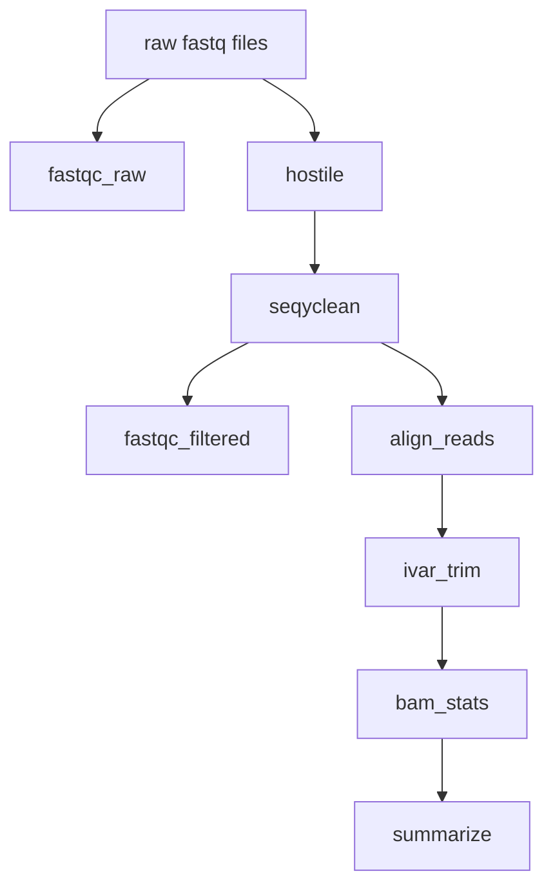

# CDPHE wastewater qPCR amplicon sequencing analysis

**Disclaimer: Next generation sequencing and bioinformatic and genomic analysis at CDPHE is not CLIA validated at this time. These workflows and their outputs are not to be used for diagnostic purposes and should only be used for public health action and surveillance purposes. CDPHE is not responsible for the incorrect or inappropriate use of these workflows or their results.**

In this repository you will find workflows and scripts for analyzing wastewater sequencing data generated from qPCR amplicons using paired-end Illumina sequencing. The general directory stucture is as follows:

```
CDPHE_wastewater_qPCR_amplicon_seq_analysis
| README.md # this document
| dockstore.yml
| workflows # terra workflow you can find in dockstore and push to your terra workspace
      | wastewater_qpcr_seq_analysis.wdl
| tasks # custom python scripts for analysess used in wdl workflows
      | hostile_task.wdl
      | version_capture.wdl  
```

## Table of Contents

1. Overview]
2. Getting Set Up
3. qPCR seq analysis workflow

## Overview

The following documentation describes the Colorado Department of Public Health and Environments's workflow for analyzing qPCR amplicon sequencing data from wastewater samples on GCP's Terra.bio platform. Workflow is written in WDL and can be imported into a Terra.bio workspace through dockstore.

Our wastewater_qpcr_seq_analysis.wdl is organism agnostic and be used to analyze paired-end Illumina sequencing of qPCR amplicons from any organism of interest, generally by running wastewater dPCR detection primers on a qPCR instrument to generate an amplicon for sequencing. Below is a high level overview of our workflow.

Briefly, using wastewater_qpcr_seq_analysis.wdl on Terra.bio, we perform human read scrubbing, quality control, trimming, and filtering of raw reads, and perform reference-based alignment of reads, and generate sequencing and mapping quality summary metrics. Following analysis, intermediate and results files are transfered to a user defined google storage bucket.

## Getting set up

Prior to running any of the workflows, you must set up the terra table and link reference files to your workspace data. Below is a list detailing the workspace data you will need to set up. See the 'Workspace Data' section for the list of required workspace data items.


## qPCR seq analysis workflow
The wastewater_qpcr_seq_analysis.wdl workflow accepts paired-end illumina sequencing data sequencing data. The workflow accepts "sample" as the root entity type. For preprocessing fastq files and generating terra data tables prior to assembly and analysis on Terra.bio, we use the following script and README (https://github.com/CDPHE-bioinformatics/seq_data_preprocessing-private).

### wastewater_qpcr_seq_analysis.wdl overview



The workflow will:
1. Use Hostile for perform human read scrubbing (if scrub_reads = true)
2. Use Seqyclean to quality filter and trim the human read scrubbed fastq files (or raw fastq files if scrub_reads = false)
  - Seqyclean parameters include a minimum read length set to 25 bp and quality trimming set to a minimum Phred quality score of 30.
3. Run FastQC on both the raw and cleaned reads
4. Align reads to the reference genome using bwa and then sort the bam by coordinates using Samtools
5. Use iVar trim to trim primer regions and then sort the trimmed bam by coordinates using Samtools
6. Use Samtools coverage to output statistics from the bam. This is done with both the default minimum depth (1x) as well as with the 10x minimum depth. 
7. generate a summary file for each sample. This will pull the percent coverage over the qPCR region from 10x minimum depth samtools coverage output, and will pull mapped reads, mean depth. mean base q, and mean mapping q from the 1x samtools coverage output
10. Use gsutils to transfer the outputs and results to a user-specified google bucket

### Inputs
1. Terra data table.

The terra data table must include the following columns as listed below. 

| column header | description | 
|:--------------------|:-----------------------------------------------------------------------------------|
|``entity:sample_id``| column with the list of sample names. (e.g. ``entity:seqrun-0001_id``)|
|``fastq_1``|The google bucket path to the R1 fastq file|
|``fastq_2``|The google bucket path to the R2 fastq file|
|``out_dir``|User defined google bucket for where the files will be transfered during the transfer task|
|``project_name``|(optional; requried for results summary workflow)|

2. Terra Workspace Data.

 The reference files can be found in this repository in the ``workspace_data`` directory. 

Required workspace data inputs:
1. adapters_and_contaminants: adapters_and_contaminants.fa, adapaters sequences and contaiment sequences removed during fastq cleaning and filtering using SeqyClean. Thanks to Erin Young at Utah Public Health Laboratory for providing this file!
2. primer_bed: a file containing the locations of the qPCR primer sequences, used for primer trimming
3. ref_genome: a fasta formated reference genome for your target of interest
4. scrub_genome_index: an optional Array[File] genome index used by hostile for human read scrubbing (required if scrub_reads = true)

3. Setting up the workflow inputs

  In addition to the Terra data table and workspace data inputs you will also need to provide the qPCR amplicon region details (chrom:start-end) as a string in double quotes as well as define scrub_reads as Boolean true/false (true = perform human read scrubbing, false = do not scrub reads). Set up the worklfow inputs on Terra.bio as follows:

  |workflow variable| attribute (input syntax into workflow) |
  |:-----------------------------|:--------------------------------------------|
  |``adapters_and_contaminants``|workspace.adapters_and_contaminants_fa|
  |``fastq_1``|this.fastq_1|
  |``fastq_2``|this.fastq_2|
  |``out_dir``|this.out_dir|
  |``primer_bed``|workspace.primers_bed|
  |``project_name``|this.project.name|
  |``qpcr_region``|"chrom:start-end"|
  |``ref_genome``|workspace.evd68_genome_fa|
  |``sample_name``|this.{entity_name}_id|
  |``scrub_reads``|true|
  |``scrub_genome_index``|workspace.hostile_human_t2t_hla_bt2|

### Outputs

| WDL task name | software/program | variable name | description |
|:--------------------------|:--------------------------------|:-------------------|:--------------------------------------------------------|
|scrub_reads|hostile|``fastq1_scrubbed``|file|
|scrub_reads|hostile|``fastq2_scrubbed``|file|
|scrub_reads|hostile|``human_reads_removed``|int|
|scrub_reads|hostile|``human_reads_removed_proportion``|int|
|seqyclean|seqyclean|``filtered_reads_1``|file|
|seqyclean|seqyclean|``filtered_reads_2``|file|
|seqyclean|seqyclean|``seqyclean_summary``|file|
|fastqc as fastqc_raw|fastqc|``fastqc_raw1_html``|file|
|fastqc as fastqc_raw|fastqc|``fastqc_raw2_html``|file|
|fastqc as fastqc_cleaned|fastqc|``fastqc_clean1_html``|file|
|fastqc as fastqc_cleaned|fastqc|``fastqc_clean2_html``|file|
|ivar trim|ivar trim and samtools|``trimsort_bam``|file|
|ivar trim|ivar trim and samtools|``trimsort_bamindex``|file|
|bam_stats|samtools coverage|``cov_out``|file|
|bam_stats|samtools coverage|``cov_out_10x`|file|
|transfer_outputs|gsutil|``transfer_date`|string|
